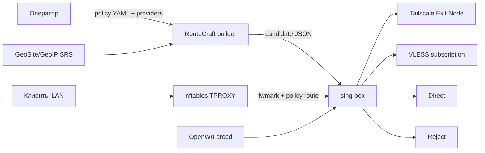

# Текущая архитектура

RouteCraft соединяет декларативную политику с проверенной конфигурацией sing-box и средствами маршрутизации OpenWrt. Текущий объём — простой однорукий gateway PoC, а не готовая реализация всех будущих компонентов.

1. `poc/policy.yaml` хранит first-match правила. Первое совпадение задаёт выход; правило default стоит последним.
2. Builder (`poc/build`) соединяет policy, список VLESS узлов и используемые SRS категории в sing-box JSON.
3. OpenWrt принимает транзитные IPv4 TCP/UDP соединения через nftables TPROXY и передаёт их локальному sing-box по fwmark/policy routing.
4. Для однорукой схемы один интерфейс обслуживает клиентов и upstream. Forwarding и SRCNAT обеспечивают обратный путь для соединений, выбравших direct.
5. procd запускает конфигурацию после загрузки; инсталлятор отдельно проверяет конфликт сетевых marks, таблиц, портов и чужих sing-box процессов.

Практический сценарий: направить сервисы, которым требуется предсказуемый адрес, в Tailscale Exit Node или на собственный VPN/VPS со статическим IP; общий видеотрафик — через VLESS subscription; оставить default direct и задать блокируемые назначения. Выбор провайдеров и их доступность остаются ответственностью владельца маршрутизатора.

В PoC подтверждены маршруты Tailscale, VLESS, direct и reject. Не подтверждены IPv6 forwarding, отдельные WAN/LAN interface groups, web UI, обновление подписки и SRS по расписанию.
