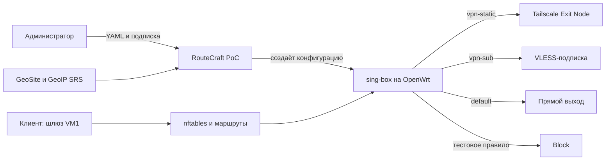

# RouteCraft: обзор архитектуры

Статус на 14.11.2026: PoC работает на тестовых VM; исправленный сетевой путь дополнительно проверен на реальном клиентском трафике. Ниже — его простая схема.

Администратор задаёт порядок правил: первое совпадение выбирает выход, условия внутри правила связаны «ИЛИ». RouteCraft готовит конфигурацию из YAML и подписки; sing-box сортирует трафик, штатные средства OpenWrt доставляют ему соединения.

Правило policy routing для TPROXY ограничено входящим LAN-интерфейсом: обратная проверка источника не направляется в локальную таблицу перехвата. Это позволяет сохранить системный `src_valid_mark`, используемый другими сетевыми службами.

Если прозрачный сокет sing-box недоступен при активном перехвате, правило блокирует транзитные IPv4 TCP/UDP-пакеты, чтобы они не обошли политику по прямому маршруту. IPv6 этим правилом не перехватывается.

Мастер установки определяет сетевые подсказки по UCI и маршрутам и может предложить сервер и выбранный или единственный доступный Exit Node запущенного локального клиента Tailscale. Встроенный endpoint sing-box регистрируется отдельно по введённому ключу; доступность выхода нужно проверить трафиком.

На VM2 проверены запросы через Tailscale, VLESS и direct, а также блокировка. Исправленные правила VM1 применялись для этого теста временно; после теста исходные правила VM1 и активный маршрут VM2 восстановлены. В изолированной среде дополнительно проверены TCP и UDP при включённом `src_valid_mark` и отказ без обхода при остановленном proxy. Порядок пересекающихся правил проверен перестановкой. Рабочая конфигурация PoC и состояние Tailscale на VM1 хранятся в `/etc/routecraft-poc` и восстанавливаются службой procd после reboot; сохранённая конфигурация VM2 указывает VM1 как шлюз, но её активный маршрут может отличаться. Автообновление подписки и UI пока не реализованы.

На VM2 также проверены установка опубликованным bootstrap и реальный клиентский IPv4-трафик при `src_valid_mark=1`: после ввода действительного ключа работали Tailscale, VLESS, direct, reject и UDP DNS. Сохранённый ранее тестовый ключ истёк и не позволил зарегистрировать новый Tailscale endpoint.

На восстановленном пользователем OpenWrt gateway опубликованный bootstrap также установил и активировал PoC; клиентская VM подтвердила те же выходы, блокировку и UDP DNS при `src_valid_mark=1`. Системный Tailscale остался запущенным. Автозапуск RouteCraft включён, но перезагрузка этого gateway в данном тесте не выполнялась.

Контрольные назначения для ручного тестирования: `2ip.io` → Tailscale, `ifconfig.me` → VLESS, `icanhazip.com` → direct, `theuselessweb.com` → reject. Эти домены указаны непосредственно в `poc/policy.yaml`.

Тестовые VM используются для разработки и испытаний. Дополнительные сетевые пространства не являются частью архитектуры продукта.
