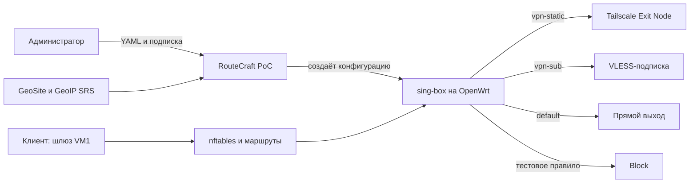

# RouteCraft: обзор архитектуры

Статус на 13.11.2026: PoC работает на тестовых VM. Ниже — его простая схема.

Администратор задаёт порядок правил: первое совпадение выбирает выход, условия внутри правила связаны «ИЛИ». RouteCraft готовит конфигурацию из YAML и подписки; sing-box сортирует трафик, штатные средства OpenWrt доставляют ему соединения.

Мастер установки определяет сетевые подсказки по UCI и маршрутам и может предложить сервер и выбранный или единственный доступный Exit Node запущенного локального клиента Tailscale. Встроенный endpoint sing-box регистрируется отдельно по введённому ключу; доступность выхода нужно проверить трафиком.

На VM2 проверены запросы через Tailscale, VLESS и direct, а также блокировка. Порядок пересекающихся правил проверен перестановкой. Рабочая конфигурация PoC и состояние Tailscale на VM1 хранятся в `/etc/routecraft-poc` и восстанавливаются службой procd после reboot; VM2 сохраняет VM1 как шлюз. Автообновление подписки и UI пока не реализованы.

Контрольные назначения для ручного тестирования: `2ip.io` → Tailscale, `ifconfig.me` → VLESS, `icanhazip.com` → direct, `theuselessweb.com` → reject. Эти домены указаны непосредственно в `poc/policy.yaml`.

Тестовые VM используются для разработки и испытаний. Дополнительные сетевые пространства не являются частью архитектуры продукта.
