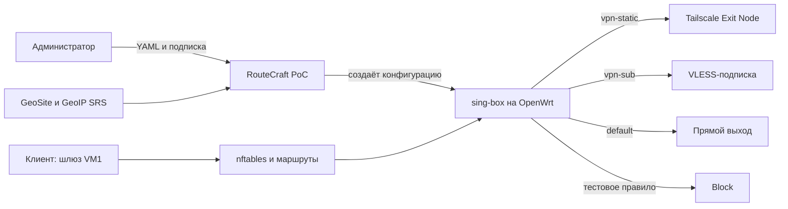

# RouteCraft: обзор архитектуры

Статус на 14.11.2026: PoC работает на тестовых VM; исправленный сетевой путь дополнительно проверен на реальном клиентском трафике. Ниже — его простая схема.

Администратор задаёт порядок правил: первое совпадение выбирает выход, условия внутри правила связаны «ИЛИ». RouteCraft готовит конфигурацию из YAML и подписки; sing-box сортирует трафик, штатные средства OpenWrt доставляют ему соединения.

Мастер по умолчанию предлагает отключить dnsmasq `rebind_protection`. Позиция RouteCraft: эта проверка не является надёжной границей безопасности, поскольку публичные резолверы вроде `1.1.1.1`, `8.8.8.8` и `8.8.4.4` также могут возвращать внутренние адреса. При согласии мастера значение сохраняется в UCI и dnsmasq перезапускается; отказ сохраняет текущую настройку.

Правило policy routing для TPROXY ограничено входящим LAN-интерфейсом: обратная проверка источника не направляется в локальную таблицу перехвата. Это позволяет сохранить системный `src_valid_mark`, используемый другими сетевыми службами.

Если прозрачный сокет sing-box недоступен при активном перехвате, правило блокирует транзитные IPv4 TCP/UDP-пакеты, чтобы они не обошли политику по прямому маршруту. IPv6 этим правилом не перехватывается.

Мастер установки определяет сетевые подсказки по UCI и маршрутам и может предложить сервер и выбранный или единственный доступный Exit Node запущенного локального клиента Tailscale. Встроенный endpoint sing-box регистрируется отдельно по введённому ключу; доступность выхода нужно проверить трафиком.

На VM2 проверены запросы через Tailscale, VLESS и direct, а также блокировка. Исправленные правила VM1 применялись для этого теста временно; после теста исходные правила VM1 и активный маршрут VM2 восстановлены. В изолированной среде дополнительно проверены TCP и UDP при включённом `src_valid_mark` и отказ без обхода при остановленном proxy. Порядок пересекающихся правил проверен перестановкой. Рабочая конфигурация PoC и состояние Tailscale на VM1 хранятся в `/etc/routecraft-poc` и восстанавливаются службой procd после reboot; сохранённая конфигурация VM2 указывает VM1 как шлюз, но её активный маршрут может отличаться. Автообновление подписки и UI пока не реализованы.

На VM2 также проверены установка опубликованным bootstrap и реальный клиентский IPv4-трафик при `src_valid_mark=1`: после ввода действительного ключа работали Tailscale, VLESS, direct, reject и UDP DNS. Сохранённый ранее тестовый ключ истёк и не позволил зарегистрировать новый Tailscale endpoint.

На восстановленном пользователем OpenWrt gateway опубликованный bootstrap также установил PoC; клиентская VM подтвердила те же выходы, блокировку и UDP DNS при `src_valid_mark=1`. После перезагрузки gateway RouteCraft, системный Tailscale и сетевые правила восстановились, а клиентские проверки повторно прошли.

Контрольные назначения для ручного тестирования: `2ip.io` → Tailscale, `ifconfig.me` → VLESS, `icanhazip.com` → direct, `theuselessweb.com` → reject. Эти домены указаны непосредственно в `poc/policy.yaml`.

Тестовые VM используются для разработки и испытаний. Дополнительные сетевые пространства не являются частью архитектуры продукта.

## Поставка и пользовательский интерфейс

Сейчас PoC распространяется bootstrap-скриптом и готовым архивом файлов, а не нативным пакетом OpenWrt. Установщик использует `apk` в OpenWrt 25.12 и новее и `opkg` в прежних выпусках. Следующий продуктовый шаг — оформить ядро/службу отдельным пакетом `routecraft`, а веб-интерфейс — необязательным пакетом `luci-app-routecraft`, который можно установить поверх обычного OpenWrt с LuCI. Это позволит сначала подключить свой feed с подписанными пакетами и обновлениями, а при появлении устойчивого релизного процесса предложить исходный пакет в официальный OpenWrt packages feed, а LuCI-приложение — в официальный LuCI feed. Попадание в эти feeds требует сопровождения и рецензии сообщества; это не условие для первого рабочего релиза.

Формат пакетов зависит от целевой ветки: OpenWrt 25.12+ использует APK v3 и индексированный APK feed, а 24.10 и более ранние версии — `ipk`/`opkg`. Один бинарный `.apk` не является универсальным форматом для всех OpenWrt. Нужно собирать пакеты OpenWrt build system/SDK для объявленной версии, target и архитектуры; Go-компонент можно собирать статически, но служба, init script, конфигурационные файлы, зависимости, миграции и LuCI ресурсы должны быть упакованы отдельно и обновляться совместимо. Текущие `poc/bundles/*.tar.gz` остаются bootstrap-артефактами PoC, пока нативные пакеты и их обновления не пройдут тестирование.

LuCI будет отдельным приложением в меню Services. Оно должно редактировать политику, показывать проверку и план изменений, запускать apply/rollback, отображать состояние выходов и результаты `doctor`/`explain`. Веб-страница не должна писать в сеть или исполнять произвольные команды сама: она вызывает тот же контроллер, которым пользуется CLI, через узкий `ubus`/`rpcd` API с явным ACL. Текущие `validate`, `compile`, `apply`, `rollback`, `status` и схемы конфигурации должны оставаться источником поведения; UI — только клиент контроллера.

Путь продвижения: сначала рабочий и обновляемый custom feed с проверкой подписи и откатом, затем независимый пакет LuCI и тесты интерфейса на чистых образах, затем публичная документация/релизы и обсуждение upstream. Для официального feed нужны сопровождающий, воспроизводимая сборка из фиксированного upstream release, корректная лицензия и зависимости, поддерживаемые версии, обновления безопасности и пакетные тесты. Требования и формат подачи надо сверять с актуальными правилами OpenWrt на момент подачи.

### Что может заменить LuCI

`Gargoyle` — другая OpenWrt-основанная прошивка со своей WebUI, но это отдельный firmware-проект с собственной матрицей устройств, а не тема или приложение для установки поверх штатного OpenWrt. `GL.iNet` предоставляет более ориентированный на бытовые сценарии интерфейс в своей модифицированной прошивке; это vendor-specific вариант, не нейтральная сменная UI для произвольного устройства. `OpenWISP` — централизованная система управления парком устройств с сервером и агентами на OpenWrt, а не более простая локальная замена LuCI на одном роутере. Темы LuCI меняют оформление, но не информационную модель и сложность настройки.

Поэтому RouteCraft сначала целится в интеграцию с обычной LuCI, не требует патчить или заменять системный интерфейс и не форкает прошивку. Если позже понадобится управлять несколькими устройствами или делать отдельный современный интерфейс, это можно оценить как отдельный frontend поверх того же контроллера/API; OpenWISP имеет смысл исследовать только при появлении задачи централизованного управления парком.

Источники: [APK в OpenWrt](https://openwrt.org/docs/guide-user/additional-software/apk), [создание пакетов](https://openwrt.org/docs/guide-developer/packages), [правила contribution для packages feed](https://git.openwrt.org/feed/packages/tree/CONTRIBUTING.md), [официальный пример LuCI-приложения и ACL](https://git.openwrt.org/project/luci/tree/applications/luci-app-example/README.md), [Gargoyle](https://github.com/ericpaulbishop/gargoyle), [OpenWISP Controller](https://openwisp.io/docs/25.10/controller/index.html).
