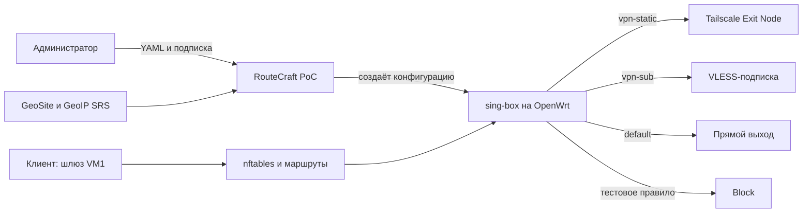

# RouteCraft: обзор архитектуры

Статус на 13.11.2026: PoC работает на тестовых VM. Ниже — его простая схема.

Администратор задаёт порядок правил: первое совпадение выбирает выход, условия внутри правила связаны «ИЛИ». RouteCraft готовит конфигурацию из YAML и подписки; sing-box сортирует трафик, штатные средства OpenWrt доставляют ему соединения.

На VM2 проверены запросы через Tailscale, VLESS и direct, а также блокировка. Порядок пересекающихся правил проверен перестановкой. PoC работает с временными файлами и правилами; после reboot его нужно запустить снова. Автообновление подписки и UI пока не реализованы.

Тестовые VM используются для разработки и испытаний. Дополнительные сетевые пространства не являются частью архитектуры продукта.
